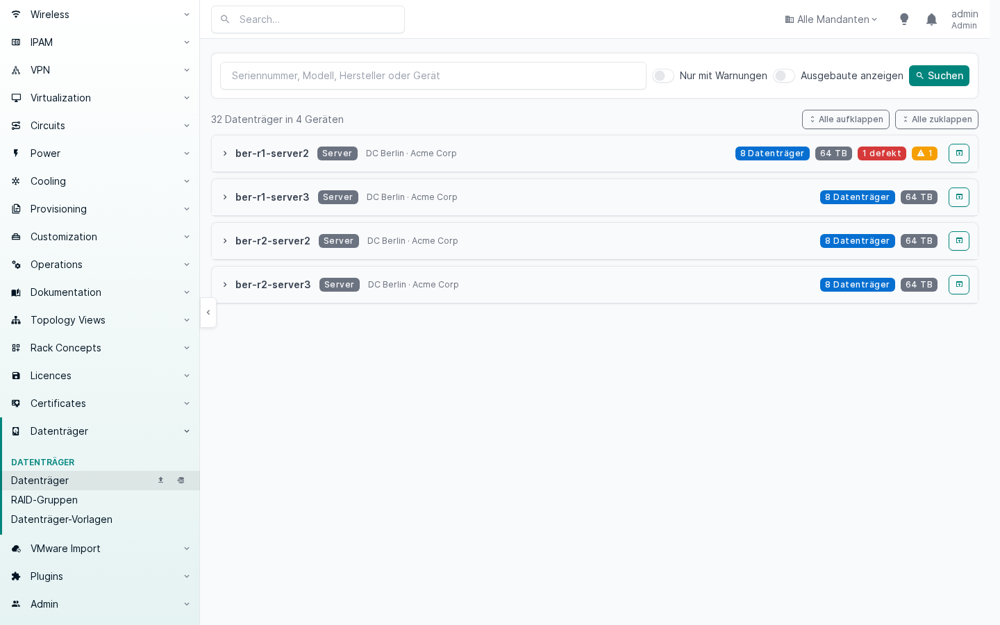
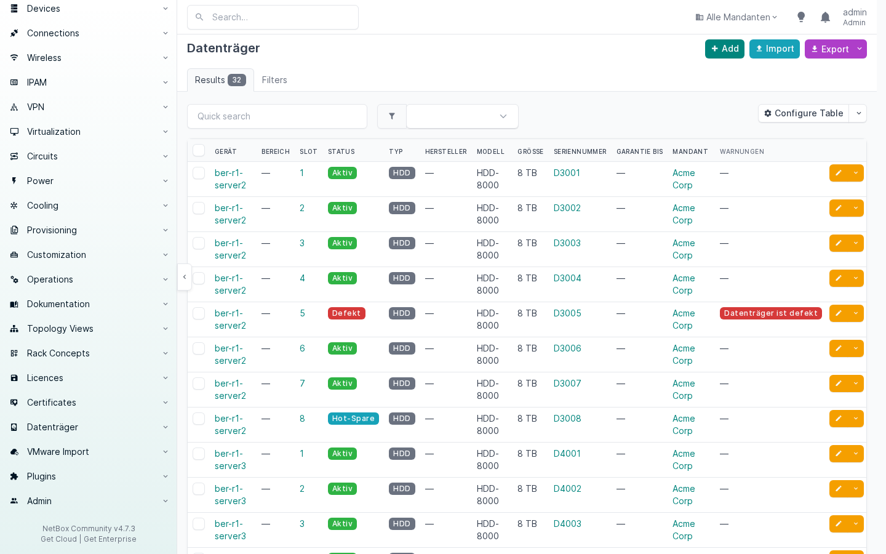
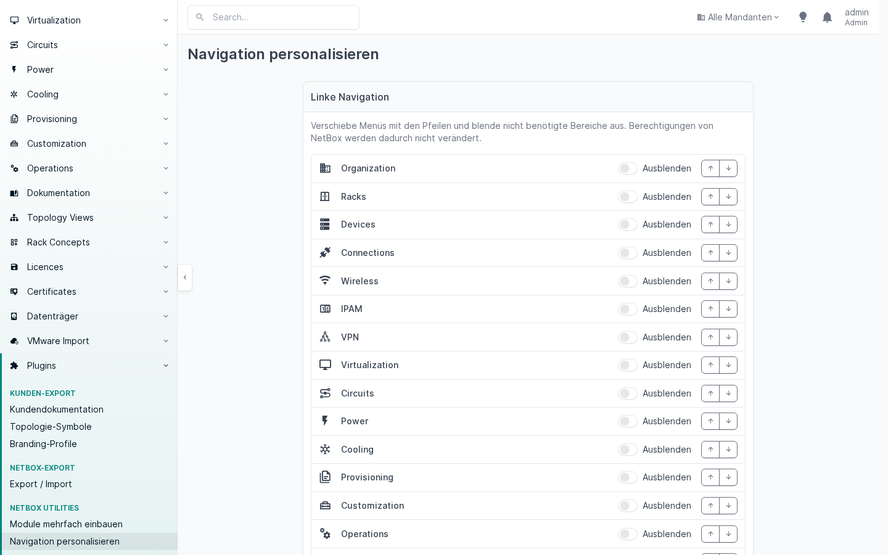
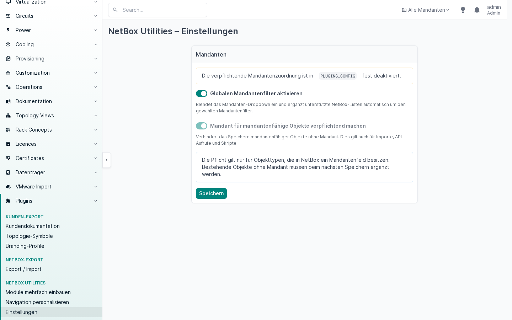

# NetBox Utilities

A collection of quality-of-life improvements for NetBox: personalised navigation,
a global tenant filter, mandatory tenancy, partial-width rack devices, bulk
uploads and more.

| | |
|---|---|
| **Plugin name** | `netbox_utilities` |
| **Package** | `netbox-utilities` |
| **NetBox** | `4.6.5` – `4.7.x` |
| **Python** | `>=3.12` |
| **Repository** | <https://git.mrblake.cc/MrBlake/Netbox-Utilities> |

## Screenshots

Disks grouped by device, with failed-disk warnings:



Disk list:



Personalised navigation:



Plugin settings:



## Features

- Every user can reorder or hide the menus of the left navigation.
- A header dropdown sets a session-wide filter for a tenant or tenant group.
- Optional mandatory tenant assignment for all tenant-aware objects.
- Automatic pre-fill of tenant and tenant group from the object or filter context.
- Automatic 1:1 mapping of front and rear ports on devices with the role `Patchpanel`.
- Devices with an optional partial width can share the same rack unit.
- The rack view of the optional [MrBlake NetBox Topology Views](https://git.mrblake.cc/MrBlake/mrb-netbox-topology-views) plugin renders partial-width devices correctly.
- Upload multiple images at once in an object's **Images** tab.
- Install multiple modules of the same type into free module bays in one step.
- Optional bulk save for devices moved in NetBox Reorder Rack.
- Rack widths are preserved by the optional [NetBox-Export](https://git.mrblake.cc/MrBlake/NetBox-Export) export/import.
- Cables and wireless links can be assigned to one or more VLANs.
- The B-side device selection of a cable can be pre-filtered by tenant group, tenant and site.
- A **Prefix** column (first word of the site name) for device and rack lists, including sorting and filtering.
- A **Disks** tab for servers, NAS, SAN and MSA devices: slot layout, disks, RAID groups, warranty and age warnings, replacement history, CSV import, HPE MSA disk export import, REST API and GraphQL.
- **CPU & RAM** per server from a built-in catalogue of 700+ Intel and AMD server CPUs since 2012, with cluster capacity and overcommit for NetBox virtualization.
- **Switch front panel** on the device page (Aruba-style, status or VLAN colours) and **switch port usage as PDF**, in the user's NetBox language.

Navigation settings are stored per user. The active tenant or tenant-group
selection is stored in the browser session.

## Compatibility

- NetBox `4.6.5` – `4.7.x`
- Python `>=3.12`
- Optional: NetBox Reorder Rack `1.1.4`
- Optional: NetBox-Export `0.3.11` or newer
- Optional: MrBlake NetBox Topology Views with rack view

Other NetBox versions are rejected on purpose, because the navigation
customisation depends on the HTML structure of the NetBox core menu.

## Installation

All paths assume a standard installation under `/opt/netbox`.

### 1. Install the package

```bash
/opt/netbox/venv/bin/pip install --upgrade --force-reinstall \
  "git+https://git.mrblake.cc/MrBlake/Netbox-Utilities.git@main"
```

For reproducible production installs, replace `main` with a release tag or a
full commit ID.

### 2. Add the plugin to `local_requirements.txt`

This makes `upgrade.sh` reinstall the plugin automatically on every NetBox upgrade:

```bash
grep -qxF "git+https://git.mrblake.cc/MrBlake/Netbox-Utilities.git@main" /opt/netbox/local_requirements.txt \
  || echo "git+https://git.mrblake.cc/MrBlake/Netbox-Utilities.git@main" | sudo tee -a /opt/netbox/local_requirements.txt
```

If the repository is private, the NetBox server needs a read-only deploy token
or an SSH key. Do not store credentials in `local_requirements.txt`. With SSH the
entry looks like this:

```text
git+ssh://git@git.mrblake.cc/MrBlake/Netbox-Utilities.git@main
```

### 3. Enable the plugin

In `/opt/netbox/netbox/netbox/configuration.py`:

```python
PLUGINS = [
    "netbox_utilities",
]

PLUGINS_CONFIG = {
    "netbox_utilities": {
        "navigation_customization_enabled": True,
        "connection_vlans_enabled": True,
        "connection_tenant_filter_enabled": True,
        "reorder_rack_bulk_save_enabled": True,
        "topology_views_rack_width_enabled": True,
        "tenant_filter_enabled": True,
        "tenant_required": True,
        "site_prefix_column_enabled": True,
        "disks_enabled": True,
        "disk_device_roles": ["Server", "NAS", "SAN", "MSA"],
        "disk_age_warning_years": 5,
        "disk_warranty_warning_days": 90,
    },
}
```

If other plugins are already configured, add `netbox_utilities` to the existing
list and dictionary instead of replacing them.

### 4. Apply migrations, collect static files, restart

```bash
cd /opt/netbox/netbox
/opt/netbox/venv/bin/python manage.py migrate netbox_utilities
/opt/netbox/venv/bin/python manage.py collectstatic --no-input
sudo systemctl restart netbox netbox-rq
```

After changes to JavaScript or CSS a hard reload in the browser (`Ctrl+F5`) may
be necessary.

### Verify the installation

```bash
/opt/netbox/venv/bin/python -c \
  "import netbox_utilities; print(netbox_utilities.__version__, netbox_utilities.__file__)"

test -f /opt/netbox/netbox/static/netbox_utilities/reorder-rack-width.js
test -f /opt/netbox/netbox/static/netbox_utilities/topology-rack-width.js

cd /opt/netbox/netbox
/opt/netbox/venv/bin/python manage.py shell -c \
  "from django.urls import reverse; print(reverse('dcim:rack_reorder', kwargs={'pk': 1})); print(reverse('plugins:netbox_topology_views:rack_elevation'))"
```

The last two routes only resolve when Reorder Rack and Topology Views are installed.

## Update

```bash
/opt/netbox/venv/bin/pip install --upgrade --force-reinstall \
  "git+https://git.mrblake.cc/MrBlake/Netbox-Utilities.git@main"

cd /opt/netbox/netbox
/opt/netbox/venv/bin/python manage.py migrate netbox_utilities
/opt/netbox/venv/bin/python manage.py collectstatic --no-input
sudo systemctl restart netbox netbox-rq
```

`--force-reinstall` makes pip pick up branch changes even if the package
version has not been bumped.

When NetBox itself is upgraded, `upgrade.sh` reinstalls the plugin from
`local_requirements.txt` and runs migrations and `collectstatic`:

```bash
sudo /opt/netbox/upgrade.sh
sudo systemctl restart netbox netbox-rq
```

If you pinned a release tag in `local_requirements.txt`, change the tag there
before running the upgrade. Test updates in a staging instance and back up the
NetBox database first.

### Migrating from NetBox Site Prefix

The Prefix column is now part of NetBox Utilities. Remove the separate
`netbox_site_prefix` plugin, otherwise the column is registered twice:

1. Remove `"netbox_site_prefix"` from `PLUGINS` in `configuration.py`.
2. Remove `git+https://git.mrblake.cc/MrBlake/Netbox-Prefixes.git` from
   `/opt/netbox/local_requirements.txt`.
3. Run `/opt/netbox/venv/bin/pip uninstall netbox-site-prefix` and restart NetBox.

The column name `site_prefix` is unchanged, so saved user table configurations keep working.

## Uninstall

1. Resolve all shared rack units first (see [Multiple devices in one rack unit](#multiple-devices-in-one-rack-unit)).
2. Remove `"netbox_utilities"` from `PLUGINS` and `PLUGINS_CONFIG`.
3. Remove the line from `/opt/netbox/local_requirements.txt`.
4. Uninstall the package and restart NetBox:

```bash
/opt/netbox/venv/bin/pip uninstall netbox-utilities
sudo systemctl restart netbox netbox-rq
```

## Configuration

| Key | Default | Description |
|---|---|---|
| `navigation_customization_enabled` | `True` | Per-user navigation ordering, hiding, resizing and icon mode |
| `connection_vlans_enabled` | `True` | VLAN assignment on cables and wireless links |
| `connection_tenant_filter_enabled` | `True` | Tenant group / tenant / site pre-filter on the cable B-side |
| `reorder_rack_bulk_save_enabled` | `True` | Bulk save integration for NetBox Reorder Rack `1.1.4` |
| `topology_views_rack_width_enabled` | `True` | Partial-width rendering in Topology Views' rack view |
| `tenant_filter_enabled` | `True` | Global tenant / tenant-group filter (overrides the UI setting) |
| `tenant_required` | `True` | Mandatory tenant assignment (overrides the UI setting) |
| `site_prefix_column_enabled` | `True` | Prefix column in device and rack lists |
| `disks_enabled` | `True` | **Disks** tab, device list column and tenant synchronisation |
| `disk_device_roles` | `["Server", "NAS", "SAN", "MSA"]` | Device role names (case-insensitive) that get the **Disks** tab |
| `disk_age_warning_years` | `5` | Warn about disks older than this (manufacture date, otherwise install date) |
| `disk_warranty_warning_days` | `90` | Warn this many days before the warranty ends |
| `hardware_enabled` | `True` | **CPU & RAM** tab, catalogue, columns and cluster capacity |
| `hardware_device_roles` | `["Server"]` | Device roles (case-insensitive) that show the **CPU & RAM** tab; cluster hosts always show it |
| `hardware_vcpu_ratio_warning` | `4` | Warn when a host or cluster has more vCPUs per physical core |
| `switch_ports_enabled` | `True` | Front panel and **Export switch port usage** button for switches |
| `switch_device_roles` | `["Switch"]` | Device roles (case-insensitive) that get the front panel and export button |

## Usage

### Prefix column in device and rack lists

Device and rack lists get a **Prefix** column as the first data column. The
value is the first word of the site name, e.g. `Berlin` for `Berlin Campus West`
or `DC01` for `DC01 Frankfurt`. Without a site the cell stays empty.

Clicking the column header sorts ascending/descending by site name. If a user
has saved a custom column selection, add **Prefix** under **Configure Table**
or reset the table configuration.

Both lists offer a **Prefix** filter in the **Site** section. The comparison is
case-insensitive and only matches the first word: `DC01` matches
`DC01 Frankfurt` but not `DC011 Hamburg`. Separate multiple prefixes with commas
(`Berlin, DC01`). The filter also works via URL and REST API, e.g.
`/dcim/devices/?site_prefix=DC01` or
`/api/dcim/racks/?site_prefix=Berlin&site_prefix=DC01`.

### Disks

Devices whose role is one of `disk_device_roles` (default `Server`, `NAS`,
`SAN`, `MSA`) get a **Disks** tab. The tab badge shows the number of
installed disks. Devices with other roles do not show the tab.

**First visit.** A wizard asks for the first slot area (default name *Front*):
the number of slots, the number of rows, the number of the first slot (usually
0 or 1, as printed by the vendor), row- or column-wise numbering and the default
form factor.

**Slot areas.** A device can have several slot areas, each with its own name,
slot count, numbering and grid, for example:

| Area | Slots | Grid |
|---|---|---|
| Front | 16 × 2.5″ | 2 × 8 |
| Rear | 2 × 2.5″ | 1 × 2 |
| BOSS card (M.2) | 2 | 1 × 2 |
| PCIe | 2 × NVMe | 1 × 2 |

Use **Add area** on the tab for disks that are not in the front bays, such as
NVMe SSDs on a PCIe card. The pencil button of an area changes its name, order,
size or numbering; slots that still hold a disk cannot be removed, and only an
empty area can be deleted. Slot numbers are unique per area, so the PCIe area
can start at slot 0 again.

**Templates.** With **Save as template for the device type** an area is stored
for the device type. The next device of the same type offers **Apply
template**, which creates all stored areas with one click; on a device that
already has areas, the button adds the missing ones. Templates are managed under
**Hardware > Disk templates** in the main menu.

**Slot grid.** Each area is drawn as its own grid and coloured by
status (active, hot spare, failed, planned). A warning icon marks disks with
expired or expiring warranty, old age or a failure. Clicking a free slot opens
the disk form with device and slot pre-filled; clicking an occupied slot opens
the disk. Users with `netbox_utilities.change_disk` can drag a disk onto a free
slot to move it, or onto an occupied slot to swap both disks, also between
areas; the change is saved immediately and recorded in the changelog.

**Filling many slots at once.** Tick several free slots of an area (or **Select
all free**) and choose **Fill selected**. All selected slots get the same
manufacturer, model, size, type, interface, dates and RAID group. Serial numbers
go into a text field, one per line, in slot order. A barcode scanner can scan
them one after another; the page counts the entries and flags duplicates live.
Serial numbers that are already installed elsewhere are rejected.

**Fields per disk.** Slot, status, type (HDD/SSD/NVMe), interface (SATA, SAS,
NVMe, SCSI, FC, USB), form factor, manufacturer, model, size, serial number,
firmware, manufacture date, install date, removal date, warranty end, RAID
group, description, comments, tags and custom fields. The size accepts vendor
notation such as `960 GB`, `4 TB`, `1,92 TB` or `2 TiB` and is stored in decimal
gigabytes. The tenant cannot be edited: it is always taken from the device and
follows the device when its tenant changes.

**RAID groups.** A RAID group belongs to one device and has a level (RAID 0,
1, 5, 6, 10, 50, 60, RAID-Z1/Z2/Z3, JBOD) and, for RAID 50/60, the number of
spans. Members are selected in the group form or per disk. Disks with status
**Hot spare** in a group count as its spares. The tab shows the usable capacity
(limited to the smallest member, as controllers do), the number of tolerated
failures, and marks groups as **Degraded** when a member is failed or
**Incomplete** when there are too few members for the level.

**Replacing a disk.** **Replace** on a disk marks it as *Removed / replaced*
with today's removal date and opens the form for the successor with slot,
model, size and RAID group pre-filled. Removed disks stay in the database: the
tab lists them under **History**, and every disk shows the history of its slot.

**Summary and warnings.** Above the grid the tab shows used/free slots, the raw
capacity, the usable RAID capacity, spares and failed disks. The warnings panel
lists failed disks, expired warranties, warranties ending within
`disk_warranty_warning_days` and disks older than `disk_age_warning_years`.

**Main menu.** The plugin adds its own **Hardware** menu with the entries
**Disks**, **RAID groups** and **Disk templates**, plus **CPU & RAM** and
**CPU models** (see below).

**Disks grouped by device.** **Hardware > Disks** shows all disks grouped by device.
Each device is a collapsible section whose header shows the device, role, site,
tenant, number of disks, raw capacity, failed disks and warnings, plus a link to
the device's **Disks** tab. The page offers a search (serial number, model,
manufacturer, device), **Only with warnings**, **Show removed** and **Expand
all** / **Collapse all**; the global tenant filter applies here as well.

**Lists, search and export.** **Table view & export** on that page opens the flat
list of all disks with filters for device, tenant, RAID group, status, type,
interface, form factor, manufacturer, warranty (expired / expiring / valid),
*older than N years* and *with warnings*. The global tenant filter applies to
this list. Export, bulk edit and bulk delete work through NetBox' standard
buttons. The NetBox global search
finds disks by serial number, model, manufacturer and firmware and shows the
device and slot. The device list offers an optional **Disks** column
(used/total, linked to the tab) under **Configure Table**; it runs two queries
per row, so enable it only where needed.

**CSV import.** **Hardware > Disks > Import** accepts CSV, JSON or YAML
with these columns: `device` (device name), `bay` (area name, may be empty when
the device has only one area), `slot`, `status`, `disk_type`,
`interface`, `form_factor`, `manufacturer`, `model`, `capacity` (e.g. `4 TB`),
`serial`, `firmware`, `manufacture_date`, `install_date`, `removal_date`,
`warranty_end`, `raid_group` (name of an existing group of that device),
`description`, `comments`, `tags`. Choice columns use the internal values, for
example `active`, `spare`, `failed`, `planned`, `replaced`, `hdd`, `ssd`, `nvme`,
`sas`, `sata`, `3.5`, `2.5`. Exports from iDRAC, iLO or storage systems need to be
mapped to these column names first.

```csv
device,bay,slot,status,disk_type,interface,manufacturer,model,capacity,serial,warranty_end
srv-01,Front,0,active,ssd,sas,Samsung,PM1643a,1.92 TB,S4XXNA0R123456,2029-05-31
srv-01,Front,1,spare,ssd,sas,Samsung,PM1643a,1.92 TB,S4XXNA0R123457,2029-05-31
srv-01,PCIe,0,active,nvme,nvme,Samsung,PM9A3,3.84 TB,S64XNA0T654321,2030-01-31
```

**HPE MSA import.** The *HPE MSA export* button next to **Hardware > Disks** (also
*MSA import* in a device's **Disks** tab) reads the CSV disk export of an HPE MSA
(*Pools → Disks*, export to CSV). The `Location` column (`1.4` = enclosure 1,
slot 4) defines the enclosures; in the next step each enclosure (shelf) is
assigned to a NetBox device. The preview shows per disk whether it is new,
updated (same serial in the same slot), replacing another disk, skipped or in
conflict (slot outside the area, serial already installed elsewhere). If a
device has no slot area yet, the area is created during the import, pre-filled
from the device type template or from the export (12 or 24 bays). `Type`,
`Size` (GiB are converted), `Disk Group`, `Revision` and `Health` are mapped;
`GLOBAL SP`/`DEDICATED SP` become hot spares, `Fault` becomes failed. Optionally
missing RAID groups are created from `Disk Group` (level *Other*) and the install
date is estimated from `Power On Hours`.

The import also accepts the **disk group export** (*Pools → Disk Groups*,
export to CSV). It sets the RAID level (`RAID10`, `RAID-5`, `R6`, `NRAID` → JBOD;
unknown levels such as ADAPT become *Other*) and a description with pool, size
and disk count on the RAID groups of the same name on the selected devices;
devices that already have such groups are pre-selected. Import the disk export
first, then the disk group export. Missing groups are only created on request.

Column names are matched loosely: case, spaces and punctuation are ignored and
common alternatives are accepted (e.g. `Serial`/`SN`, `Capacity`, `Vendor`,
`Firmware`, separate `Enclosure` and `Slot` columns). Positions may be written
as `1.4`, `1:4`, `1/4` or `Enclosure 1, Slot 4`. Comma, semicolon and tab
separated files in UTF-8 or Windows-1252 work. Both MSA exports are also
recognised when uploaded in the regular disk CSV import and handed over to the
MSA import automatically.

**REST API and GraphQL.**

| Endpoint | Content |
|---|---|
| `/api/plugins/utilities/disks/` | Disks, incl. read-only `tenant` and `warnings` |
| `/api/plugins/utilities/raid-groups/` | RAID groups, incl. `usable_capacity_gb` and `is_degraded` |
| `/api/plugins/utilities/disk-bay-layouts/` | Slot areas per device (`name`, `weight`, slot count, grid) |
| `/api/plugins/utilities/disk-bay-templates/` | Slot area templates per device type |

The disk endpoint supports the same filters as the list, e.g.
`?device_id=12&status=failed`, `?serial=S4XXNA0R123456`, `?warranty=expiring` or
`?has_warnings=true`. GraphQL offers `netbox_utilities_disk(_list)`,
`netbox_utilities_raid_group(_list)`, `netbox_utilities_disk_bay_layout(_list)`
and `netbox_utilities_disk_bay_template(_list)`.

**Permissions.** The tab requires `netbox_utilities.view_disk`. Setting up the
layout and filling slots requires `netbox_utilities.add_disk`, replacing
requires `netbox_utilities.change_disk`, and RAID groups use the
`netbox_utilities.*_raidgroup` permissions.
The HPE MSA import requires `netbox_utilities.add_disk`; updating or replacing
existing disks additionally requires `netbox_utilities.change_disk`, and creating
RAID groups `netbox_utilities.add_raidgroup` (otherwise they are skipped).

### CPU & RAM

Servers and virtualization hosts get a **CPU & RAM** tab next to **Disks**.
It is shown for devices whose role is listed in `hardware_device_roles`, for
every device assigned to a cluster, and for every device that already has CPU &
RAM recorded; the badge shows the total number of cores. **Add** opens a form
with:

- **CPU model**: a searchable select over the catalogue. Typing `6338`,
  `Gold 6338` or `epyc 7543` is enough; each entry shows cores, threads and
  base/turbo clock.
- **Number of CPUs** (populated sockets). It is checked against the maximum
  socket count of the model, e.g. EPYC "P" models are single-socket only.
- **RAM**: number and size of the modules, total RAM (calculated from modules ×
  size when left empty), type (DDR3/DDR4/DDR5) and speed in MT/s.

The tab then shows e.g. *2 × Intel Xeon Gold 6338 · 64 cores / 128 threads ·
1 TB (16 × 64 GB DDR4-3200)*. The device list offers the optional columns
**CPU**, **Cores / Threads** and **RAM** under **Configure Table**.

**CPU catalogue.** **Hardware > CPU models** lists about 700 server CPUs:

| Vendor | Families |
|---|---|
| Intel | Xeon E5-2600/2400/4600/1600 v1–v4, E7 v2–v4, E3-1200 v2–v6, Xeon E-2100 to E-2400, Xeon 6300P, Xeon Scalable 1st–5th Gen (Skylake to Emerald Rapids), Xeon 6 (Sierra Forest, Granite Rapids), Xeon 6+ (Clearwater Forest) |
| AMD | Opteron 4300/6300, EPYC 7001/7002/7003 (incl. F and X models), 9004 (Genoa, Genoa-X, Bergamo), 8004, 4004, 4005, 9005 (Turin) |

Each entry has cores, threads, base and turbo clock, TDP, socket, launch year
and maximum socket count. The values were checked against Intel ARK, AMD and
server vendor specifications. Missing models can be added in the UI or by CSV
import; catalogue entries can be edited, too. The catalogue is loaded by the
migration and refreshed after a plugin update with:

```bash
cd /opt/netbox/netbox
../venv/bin/python manage.py netbox_utilities_cpu_catalog          # add new models, keep edited ones
../venv/bin/python manage.py netbox_utilities_cpu_catalog --force  # also reset edited catalogue entries
```

Models you created yourself are never changed by the command.

**Virtualization.** CPU & RAM work together with NetBox clusters and virtual
machines (vCPUs and memory of the VM):

- **Cluster page:** a **Capacity (CPU & RAM)** panel sums the hosts (devices
  of the cluster) and compares them with the VMs: physical cores/threads and
  RAM, allocated vCPUs and RAM, the vCPU-to-core ratio, RAM allocation in
  percent and the RAM that remains if the largest host fails (N+1). A table
  lists every host with its CPU, VMs, ratio and RAM usage; hosts without CPU &
  RAM are flagged with a link to record them.
- **Host (device):** the CPU & RAM tab adds the capacity of that host and a
  list of the VMs running on it (VMs whose *Device* is set).
- **VM page:** a **Host hardware** panel shows the CPU of the host, or of the
  cluster hosts if the VM has no fixed host, and warns if the VM has more
  vCPUs than the host has threads.
- **Cluster list:** the optional column **vCPU : core · RAM** shows the ratio
  and RAM allocation per cluster.

Warnings appear when VMs are allocated more RAM than the hosts have, when the
RAM no longer fits after the failure of the largest host, and when the vCPU
ratio exceeds `hardware_vcpu_ratio_warning`. VMs with the status *Offline* or
*Decommissioning* are not counted.

VMs that are assigned only to a cluster, without a fixed host (*Device*), are
spread over the cluster hosts in proportion to their size: vCPUs by the number
of threads, memory by the host RAM. A host with twice the threads carries twice
the vCPUs of these VMs. If no host of the cluster has CPU & RAM recorded, the
load is split evenly. As soon as a single VM of the cluster (in any status) is
assigned to one of its hosts, the placement counts as managed by hand: nothing
is spread, and the VMs without a host only count towards the cluster totals. The cluster table and the CPU & RAM tab of each host
include this share and mark it as such; the cluster totals count every VM once. VM memory is read in MB as NetBox stores it.

**CSV import.** **Hardware > CPU & RAM > Import** accepts `device` (name),
`cpu` (catalogue model name, e.g. `Xeon Gold 6338`), `cpu_count`, `memory_gb`,
`memory_type` (`ddr3`, `ddr4`, `ddr5`), `memory_modules`, `memory_module_gb`,
`memory_speed_mts`, `description`, `comments` and `tags`.

```csv
device,cpu,cpu_count,memory_modules,memory_module_gb,memory_type,memory_speed_mts
esx01,Xeon Gold 6338,2,16,64,ddr4,3200
esx02,EPYC 9354,2,24,32,ddr5,4800
```

**REST API and GraphQL.** `/api/plugins/utilities/cpu-models/` and
`/api/plugins/utilities/device-hardware/` (with read-only `total_cores` and
`total_threads`); filters include `?q=6338`, `?manufacturer=amd`,
`?cores__gte=32`, `?cluster_id=4` and `?cpu_id=17`. GraphQL offers
`netbox_utilities_cpu_model(_list)` and `netbox_utilities_device_hardware(_list)`.

**Permissions.** The tab and panels require `netbox_utilities.view_devicehardware`;
recording and editing use `netbox_utilities.add_devicehardware` and
`netbox_utilities.change_devicehardware`. The catalogue uses the
`netbox_utilities.*_cpumodel` permissions.

### Switch front panel

On the **Device** tab of a switch (role from `switch_device_roles`) a **Ports**
panel appears above the *Device* and *Management* cards, similar to the port
view in the web interface of Aruba switches:

- A dark faceplate with every physical port as an RJ45 or SFP jack, odd ports
  on top and even ports below, grouped per stack member or line card.
- **Status** view: green = link/connected, empty jack = free, red dot = disabled.
- Management ports (marked *management only* or named `mgmt`, `management`,
  `oobm`, `me0` …) are shown as **MGMT** in a group of their own at the end.
- The faceplate follows NetBox's light and dark theme.
- **VLAN** view: every VLAN from the interface label gets its own colour (the
  same colours as in the PDF), the VLAN is printed in the jack and the text
  colour is chosen for contrast; free ports are dimmed, connected ports framed.
  A legend lists every VLAN with connected/total ports.
- Hovering shows name, status, VLAN, peer and description; clicking opens the
  interface. The header shows the key figures and links to the PDF export.
- The chosen view is remembered in the browser; texts follow the user's NetBox
  language (German or English).

**VLANs from labels and cables.** Besides the interface label, the VLANs
assigned to the port's cable (see *VLANs on connections*) are taken into
account, in the front panel and in the PDF:

- A port with a label shows the label; a port without a label shows the VLANs
  of its cable (e.g. `10` or `10, 20`).
- A label with exactly one number is that VLAN ID, so `Server 30`, `VLAN 30`,
  `30` and a cable with VLAN 30 share one colour and one legend entry (named
  after the label). Labels like `Trunk` or `10,20` stay as they are.
- If the numbers in the label differ from the cable VLANs (label `20`, cable
  VLAN 30), the port gets an orange corner and the tooltip and the PDF port
  list show a warning. Labels without a number never count as a mismatch.
- Tooltips and the PDF port list show both the label and the cable VLANs with
  their names.
- A LAG note in the label such as `10,20 (LAG 1)` (written by NetBox
  Synchronizer for LAG members) is shown, but ignored for VLAN colours, the
  legend and the mismatch check.

NetBox offers plugins no slot above these cards, so the panel is rendered into
the left column and moved to the top by a small script; without JavaScript it
stays in the left column.

**Switch stacks via REST API.** The stack set in the device form (*Switch-Stack*
and *Stack-Mitglieder*) can also be read and written through
`/api/plugins/utilities/switch-stacks/`: `device` is the stack switch, `members`
the IDs of the further member devices. Filter with `?device_id=` or
`?member_id=`. The model has no change log and no tags; permissions are
`netbox_utilities.*_switchstack`. NetBox Synchronizer uses this endpoint to fill
in detected stacks.

### Switch port usage (PDF)

Devices with a role from `switch_device_roles` get an **Export switch port
usage** button (*Switch-Belegung exportieren*) on the device page. It
downloads a PDF (A4 landscape) with:

- **Header:** device, site, rack/position, model and date, plus the key
  figures: physical ports, connected (with percentage), free and disabled.
- **Front panel:** every physical interface as a tile, arranged like the
  device front with odd ports on top and even ports below, grouped per stack
  member or line card (`Gi1/0/…`, `Gi2/0/…`); SFP/QSFP ports are shown
  separately. Each tile shows the port number and the VLAN from the interface
  **label**. Every VLAN gets its own colour (`VLAN 10`, `vlan10` and `10` count
  as the same VLAN); connected ports are filled with the full colour and a
  thick border, free ports with a pale version, disabled ports have a dashed
  border and a small ✕. The text colour is chosen per tile for the best
  contrast (black or white). A 48-port switch fits on one row; wider groups
  are split evenly.
- **Legend:** every VLAN with its colour and connected/total ports.
- **Port list:** all interfaces (including virtual ones such as LAGs and SVIs)
  with status, VLAN label, peer, description, type and LAG. The peer is the
  far end through patch panels when the cable path is complete, otherwise the
  directly cabled object; interfaces marked as connected count as used.

The PDF follows the language set in the user's NetBox preferences (German or
English; other languages fall back to German). The button requires
`dcim.view_interface`. The PDF is generated with
[ReportLab](https://pypi.org/project/reportlab/), which is installed together
with the plugin; it needs no system libraries.

### Pre-filter for the B-side of a cable

When creating or editing a cable, the **B-side** section shows optional
**Tenant group**, **Tenant** and **Site** fields above the device selection.
They filter the B-side dropdowns live (devices, power panels — site only — and
circuits).

The fields are pre-filled with the tenant and site of the selected A-side if
they are unambiguous, otherwise with the tenant or tenant group of the global
header filter.

This is only a **pre-filter**: the values are not stored on the cable. To cable
across tenants or sites, simply clear the field. The tenant filter uses the
device's own `tenant` field; devices whose tenant is only implied by their site
do not appear — use the site filter in that case.

### VLANs on connections

The create/edit form of cables and wireless links has an optional
**Connection VLANs** field. One or more existing VLANs can be selected; the
assignment is also shown on the connection's detail page.

It documents which VLANs are carried over the connection. It intentionally does
**not** change the **Untagged VLAN** / **Tagged VLANs** of the connected
interfaces, since both ends can use different interface modes.

- Applies to physical cables (including paths through patch panels) and `WirelessLink`s.
- In the cable form the field sits in the **B-side** section, below the B-side termination.
- An optional **VLAN group** field acts as a dynamic filter for the VLAN selection; it is not stored.
- Empty selections create no record; deleting a connection removes its VLAN assignment.
- With NetBox-Export installed, the assignments are exported and imported together with connections and VLANs.

### Multiple devices in one rack unit

The regular device create/edit form gets two optional fields right after **Position**:

- **Rack width**: full, half, third or quarter width;
- **Width position**: position 1 to 4, counted from the left.

Example: for a router and a second device in the same U, choose **1/2 rack width**
for both, give the router **Position 1 (left)** and the other device
**Position 2**. Rack, U and face may then be identical. Collision checks take
height and width into account; multi-U devices are supported. The width
position updates immediately when the rack width changes.

Without a width, a device occupies the full rack width as before. If two to
four devices already share a U and face without plugin placements, the display
splits the space evenly between them. This does not change database values.

NetBox enforces a unique constraint on rack, U and face. Plugin migration
`0007` removes only this core constraint so that multiple devices can share a U;
the plugin performs the width-aware check on save instead. **Before removing the
plugin, shared rack units must be resolved** — the constraint is not restored
automatically on uninstall.

The extra fields are maintained in the web form. REST or standard CSV
operations without these fields treat new devices as full width; the portable
ZIP export of NetBox-Export does transfer them.

### Rack widths in NetBox-Export

With [NetBox-Export](https://git.mrblake.cc/MrBlake/NetBox-Export) installed,
NetBox Utilities extends its ZIP export and import automatically. Rack width and
width position are stored for every device. The import conflict check considers
both height and horizontal rack space, so two half-width devices can be imported
into the same U. Full width is stored explicitly, so a device reset to full
width in a newer export loses its stale partial-width placement. Older archives
without these metadata remain importable.

### Partial widths in MrBlake NetBox Topology Views

If [MrBlake NetBox Topology Views](https://git.mrblake.cc/MrBlake/mrb-netbox-topology-views)
with its **rack view** is installed, NetBox Utilities detects it automatically.
Partial-width devices are rendered side by side, including the **SVG**, **PNG**
and **draw.io** exports. The cable topology is unchanged.

Both plugins must be enabled (order does not matter):

```python
PLUGINS = [
    "netbox_topology_views",
    "netbox_utilities",
]
```

The integration does not modify Topology Views' files and creates no database
records. Disable it with `topology_views_rack_width_enabled = False`.

### Automatic front/rear port mapping for patch panels

Devices whose role is named `Patchpanel` (case-insensitive) are treated as patch
panels. The plugin maps ports with the same number on port position 1:
`Front 1` ↔ `Rear 1`, `Front 2` ↔ `Rear 2`, and so on. Short forms such as
`F01` and `R1` and additional labels such as `LC` are recognised. If the
counterpart is missing, the port stays unmapped; following numbers do not shift.

The mapping is only created when a patch panel is first created, a new module
is installed, or a new front or rear port is created. Editing existing objects
does not trigger it, and there is no automatic run over existing data on
install or update.

### Moving multiple devices with NetBox Reorder Rack

With `netbox-reorder-rack` `1.1.4` installed and enabled, NetBox Utilities
extends its save action: several devices can be moved or swapped in the
drag-and-drop view and saved together via **Save**. Partial-width devices are
shown side by side on a 12-column grid and snap to valid positions; height,
face and width position are saved in one transaction.

```bash
/opt/netbox/venv/bin/pip install "netbox-reorder-rack==1.1.4"
echo "netbox-reorder-rack==1.1.4" | sudo tee -a /opt/netbox/local_requirements.txt
```

```python
PLUGINS = [
    "netbox_reorder_rack",
    "netbox_utilities",
]
```

Reorder Rack's files are not modified; its UI and API are extended at startup.
On save, all affected devices and the rack are locked and validated with the
normal NetBox model validation. If any placement, validation or permission
error occurs, the whole rack stays unchanged. Every moved device still gets a
normal changelog entry. Versions other than `1.1.4` are left untouched and only
produce a log message.

### Uploading multiple images

In the **Images** tab of supported objects, the single upload is replaced by
**Upload multiple images**. Up to 50 images can be selected at once, with
previews before saving. Each file is validated by NetBox; if one is invalid,
none are saved. An optional shared description can be applied; the original
file name is kept as the display name. Requires permission to add image
attachments and to view the target object.

NetBox caps Pillow at 25 megapixels, which breaks current 50 MP smartphone
photos (e.g. Google Pixel, 8160×6144) and their thumbnails. The bulk upload
therefore scales larger images down to NetBox' limit (EXIF orientation is
applied) before saving. If an image is rejected, the form also shows Pillow's
exact error message.

### Installing multiple modules

Under **Plugins > NetBox Utilities > Install multiple modules** (or via the
button on device pages with free module bays), choose a device, a module type
and several free module bays — or enter a **Quantity (1–x)** to use the first
free bays in natural order. All modules get the same type, status and
description; component replication from the module type templates is optional.
The operation is atomic: if a bay is taken meanwhile or a naming conflict
occurs, nothing is saved. Requires the permission to add modules; object
permissions still apply.

### Personalised navigation

Under **Plugins > NetBox Utilities > Customize navigation** users see every menu
they have access to. Arrow buttons change the order; a toggle hides a menu.

The desktop sidebar can be resized between 216 and 408 px by dragging its right
edge. A small handle collapses it into an **icon mode** where menus open as a
flyout (closed on selection, outside click or Escape). **Reset** restores order,
visibility and the default width of 288 px.

### Global tenant and tenant-group filter

The building icon in the header opens the selection of tenants and tenant
groups the user may see. A tenant group includes tenants of its child groups.
**All tenants** removes the filter.

The filter:

- enforces `tenant_id` or `tenant_group_id` in supported NetBox lists;
- restricts the tenant list itself;
- restricts NetBox global search results;
- applies to HTMX table updates and exports from filtered lists;
- does **not** change REST or GraphQL requests.

Superusers can disable it at runtime under **Plugins > NetBox Utilities > Settings**;
`tenant_filter_enabled = False` disables it permanently and takes precedence.

### Mandatory tenant assignment

Enabled by default under **Plugins > NetBox Utilities > Settings**. For all
object types with a `tenant` field, the field becomes required — in forms, CSV
imports, the REST API and `Model.save()` calls from scripts. Existing objects
without a tenant remain until they are next saved. Global reference models
without a `tenant` field are not affected.

When a form opens, missing values are pre-filled carefully: first from a
recognisable parent object (rack, site, device, cluster, …), otherwise from the
global tenant filter. Existing values are never overwritten. For cables, both
cable ends are evaluated; the tenant is only set if it is unambiguous. If an
automatically set tenant is saved unchanged, the browser asks for an explicit
confirmation.

`tenant_required = False` disables the feature permanently and takes precedence
over the UI setting.

## Important semantics

The tenant filter is a **view filter, not access control**. Direct object URLs
are not blocked; NetBox object permissions remain the security boundary. The
mandatory tenant assignment, however, is server-side data validation.

Only models with a tenant relation are filtered. Global reference data such as
manufacturers, roles or platforms stays visible.

The sidebar personalisation uses NetBox's official global
`PluginTemplateExtension` and reorders the already rendered core menus in the
browser. It changes neither core templates nor NetBox files.

## Development and tests

In a NetBox development environment:

```bash
pip install -e /path/to/Netbox-Utilities
python netbox/manage.py test netbox_utilities
```

## License

See [LICENSE](LICENSE).
